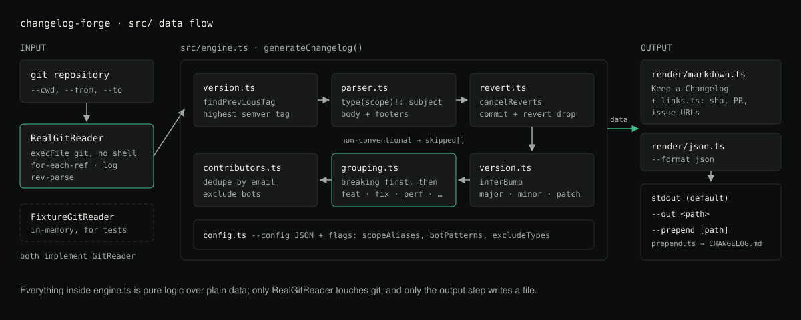

# changelog-forge

Generate a release changelog from conventional commits, grouped by impact, with breaking
changes surfaced first.



## What it does

`changelog-forge` reads a git repository's commit history, parses each commit as a
[Conventional Commit](https://www.conventionalcommits.org/), and produces a changelog ordered
by *impact* rather than by commit order: breaking changes first (with their migration notes),
then features, then fixes, then performance improvements, reverts, and deprecations. Noise
types (`chore`, `ci`, `style`, `test`) are excluded by default. It also infers the semver bump
the release implies, and can write Markdown (Keep a Changelog shape) or JSON.

## Why use it

Many changelog generators print commit subjects in commit order, so a single breaking change
can end up below dozens of `chore:` entries. A reader deciding whether it is safe to upgrade
needs the breaking changes and their migration notes first, so this tool puts them first.

## Features

- **Conventional-commit parsing**: `type(scope)!: subject`, body, and git-trailer-style
  footers, including folded (multi-line) footer values.
- **Both breaking-change notations**: the `!` marker after the type/scope, and a
  `BREAKING CHANGE:` / `BREAKING-CHANGE:` footer. Tools that only support one of these
  miss breaking changes written the other way.
- **Impact ordering**: breaking changes surfaced first with migration notes, then features,
  fixes, performance, reverts, deprecations. `chore`/`ci`/`style`/`test` are excluded by
  default but can be included.
- **Scope grouping** within each section, with configurable scope aliases (e.g. `fe`/`ui` both
  folding into `frontend`).
- **Version inference** from the commits themselves: any breaking change → major, else any
  `feat` → minor, else any `fix`/`perf` → patch. The recommended bump is printed in the output.
- **Range selection**: explicit `--from`/`--to` refs, or auto-detection of the previous release
  by **semver ordering**, not tag creation date (which is wrong when tags are pushed out of
  order, e.g. a `1.2.0` hotfix tag pushed after a `1.3.0-rc.1` prerelease tag).
- **Revert cancellation**: a commit and its revert, when both are in the range, cancel out
  instead of both appearing. Both `revert: <header>` and the default `git revert` message
  (`Revert "<header>"` + `This reverts commit <sha>.`) are recognised.
- **Link generation** for commit SHAs, PR numbers (`(#123)` in the subject), and issue
  references, from a configurable repository URL.
- **Contributor list**, deduplicated by email, with bots excluded by configurable pattern.
- **Markdown or JSON output**, and `--prepend` to insert a new release into an existing
  `CHANGELOG.md` above previous releases without disturbing them.

## Architecture

Git access sits behind a `GitReader` interface (`src/git/GitReader.ts`) with two
implementations:

- `RealGitReader`: shells out to the system `git` binary against a real repository.
- `FixtureGitReader`: an in-memory reader for tests, given commits and tags directly.

Everything downstream of `GitReader` is pure logic over plain data, so it can be unit-tested
without a repository: conventional-commit parsing (`src/parser.ts`), revert cancellation
(`src/revert.ts`), version inference (`src/version.ts`), impact-ordered grouping
(`src/grouping.ts`), contributor collection (`src/contributors.ts`), link generation
(`src/links.ts`) and rendering (`src/render/`). `src/engine.ts` wires it together;
`src/cli.ts` is the command-line entry point.

```
src/
  types.ts             shared data shapes
  semver.ts            semver parsing/comparison/bumping
  parser.ts            conventional-commit parsing
  revert.ts            revert/original commit cancellation
  version.ts           previous-tag detection + bump inference
  grouping.ts          impact ordering + scope grouping
  contributors.ts       contributor list (dedup + bot exclusion)
  links.ts             commit/PR/issue link generation
  config.ts            config loading/merging/defaults
  engine.ts            orchestrates the above into ChangelogData
  index.ts             library entry point (re-exports the modules)
  prepend.ts           insert a release into an existing CHANGELOG.md
  render/
    markdown.ts        Keep a Changelog-shaped Markdown
    json.ts            JSON output
  git/
    GitReader.ts        interface
    RealGitReader.ts     real `git` implementation
    FixtureGitReader.ts  in-memory implementation for tests
  cli.ts               argument parsing + command-line entry point
```

## Installation

This project is **not published to npm**. The `changelog-forge` package on the npm
registry is an unrelated project by another author; do not `npm install` it or run
`npx changelog-forge` expecting this tool. Install from a clone:

```bash
git clone https://github.com/hellpuffyt/changelog-forge
cd changelog-forge
npm ci && npm run build
npm link            # puts `changelog-forge` on your PATH
```

The examples below use the linked `changelog-forge` command; `node dist/cli.js ...` from the
clone works too. Do not substitute `npx changelog-forge`: if the linked command is not found,
`npx` falls back to downloading the unrelated registry package.

Requires Node.js `^20 || ^22 || >=24` and the `git` binary on `PATH`. CI runs on Ubuntu with
Node 20, 22 and 24.

## Usage

Run from inside a git repository (or point `--cwd` at one):

```bash
changelog-forge --repo-url https://github.com/owner/repo
```

This auto-detects the previous release tag (by semver, not creation date), reads commits from
there to `HEAD`, and prints a Markdown release section to stdout.

```bash
# Explicit range
changelog-forge --from v1.2.0 --to v1.3.0 --repo-url https://github.com/owner/repo

# JSON output
changelog-forge --format json --out changelog.json

# Insert into (or create) CHANGELOG.md, above previous releases
changelog-forge --repo-url https://github.com/owner/repo --prepend

# Include normally-excluded types
changelog-forge --include chore,ci

# Override the inferred version
changelog-forge --version 2.0.0
```

### CLI options

| Flag | Description |
| --- | --- |
| `--from <ref>` | Start of the commit range (exclusive). Defaults to the auto-detected previous tag. |
| `--to <ref>` | End of the commit range (inclusive). Defaults to `HEAD`. |
| `--repo-url <url>` | Repository URL used to build commit/PR/issue links. |
| `--config <path>` | Path to a JSON config file. |
| `--prepend [path]` | Insert into an existing changelog file above previous releases. Defaults to `CHANGELOG.md`. |
| `--format <markdown\|json>` | Output format. Defaults to `markdown`. |
| `--out <path>` | Write output to a file instead of stdout. |
| `--cwd <path>` | Git repository directory. Defaults to the current directory. |
| `--include <types>` | Comma-separated types to include even if normally excluded. |
| `--version <semver>` | Explicit release version, overriding inference. |
| `-h`, `--help` | Show help. |

## Configuration

Pass `--config path/to/config.json`:

```json
{
  "repoUrl": "https://github.com/owner/repo",
  "scopeAliases": {
    "fe": "frontend",
    "ui": "frontend"
  },
  "botPatterns": ["\\[bot\\]$", "^dependabot", "^renovate"],
  "excludeTypes": ["chore", "ci", "style", "test"],
  "includeTypes": []
}
```

- `scopeAliases`: maps a raw commit scope to a canonical display scope; commits sharing a
  canonical scope are grouped together.
- `botPatterns`: case-insensitive regular expressions tested against contributor name and
  email; matches are excluded from the contributor list.
- `excludeTypes`: commit types dropped from the output entirely (breaking changes are never
  dropped, even if their type is excluded).
- `includeTypes`: types to keep even if listed in `excludeTypes` (also settable per-run with
  `--include`).

## Examples

Given these commits since the last tag:

```
fix(auth): handle expired session (#12)
feat(api)!: change response envelope

BREAKING CHANGE: responses are now wrapped in a `data` key.
perf(db): add index on user id
```

`changelog-forge` produces:

```markdown
## [2.0.0] - 2026-08-30

_Recommended bump: **major**._

### BREAKING CHANGES

#### api

- change response envelope ([`05cc3de`](https://github.com/owner/repo/commit/05cc3de...))

  responses are now wrapped in a `data` key.

### Bug Fixes

#### auth

- handle expired session (#12) ([#12](https://github.com/owner/repo/pull/12) [`4626081`](https://github.com/owner/repo/commit/4626081...))

### Performance Improvements

#### db

- add index on user id ([`66bbede`](https://github.com/owner/repo/commit/66bbede...))

### Contributors

- Demo User
```

Note that the newest commit (`fix(auth)`) is not listed first: sections are ordered by
impact, not commit date, and breaking changes always lead. The date and commit SHAs come from your
repository, so they will differ.

## Output format

**Markdown** follows the [Keep a Changelog](https://keepachangelog.com/) shape: an `## [version]
- date` heading, `### Section` headings in impact order, and `#### scope` subheadings within a
section when commits carry a scope. Unscoped commits in a section are listed first.

**JSON** mirrors the same structure programmatically; see `src/render/json.ts` for the exact
shape (`version`, `bump`, `date`, `from`, `to`, `sections[].groups[].entries[]`, `contributors`,
`skipped`).

## Testing

```bash
npm test            # vitest run, 145 tests in 16 files
npm run typecheck   # tsc --noEmit, strict
npm run lint        # eslint ., zero errors, zero warnings
npm run build       # tsc -p tsconfig.build.json -> dist/
```

Parsing, grouping, version inference, revert cancellation, and rendering are all tested against
the in-memory `FixtureGitReader`, with no repository required. `test/git/RealGitReader.test.ts` and
`test/cli.test.ts` create a real temporary repository with `git init` and exercise the actual
`git` binary end to end.

## Security

- `changelog-forge` only *reads* from the repository it's pointed at (`git log`, `git
  for-each-ref`, `git rev-parse`); it never writes to git history or pushes anything.
- The only file it writes is the output file you specify via `--out` or `--prepend`.
- Config files are parsed as plain JSON (`JSON.parse`), not evaluated as code.
- git is run with `execFile` (no shell) and a fixed argument list. `--from`/`--to`
  values are rejected if they start with `-` or contain whitespace/control characters,
  and are passed after `--end-of-options`, so input can never become a git option (such
  as `--output=<file>`). `log.showSignature` is forced off so a repository's config
  cannot make `git log` run a signature program.
- Report a security issue privately as described in [SECURITY.md](SECURITY.md) rather than in
  a public issue.

## Limitations

- The version in the heading is inferred only when the range starts at an auto-detected
  release tag. With an explicit `--from <tag>`, the heading is `## [Unreleased]` (the
  recommended bump is still printed); pass `--version` to set it.
- With no semver tag in the repository, the whole history up to `--to` is read.
- Commits that are not Conventional Commits are left out of the sections and listed under
  `skipped` in JSON output.

## Contributing

See [CONTRIBUTING.md](CONTRIBUTING.md).

## License

MIT. See [LICENSE](./LICENSE).
